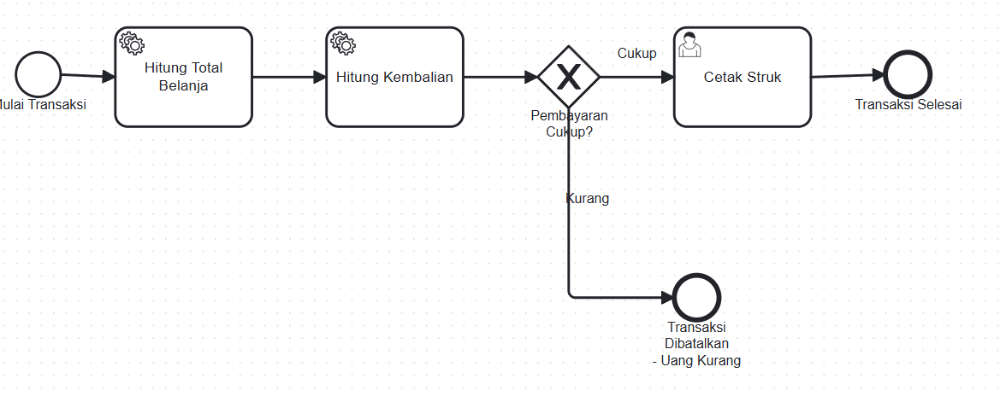
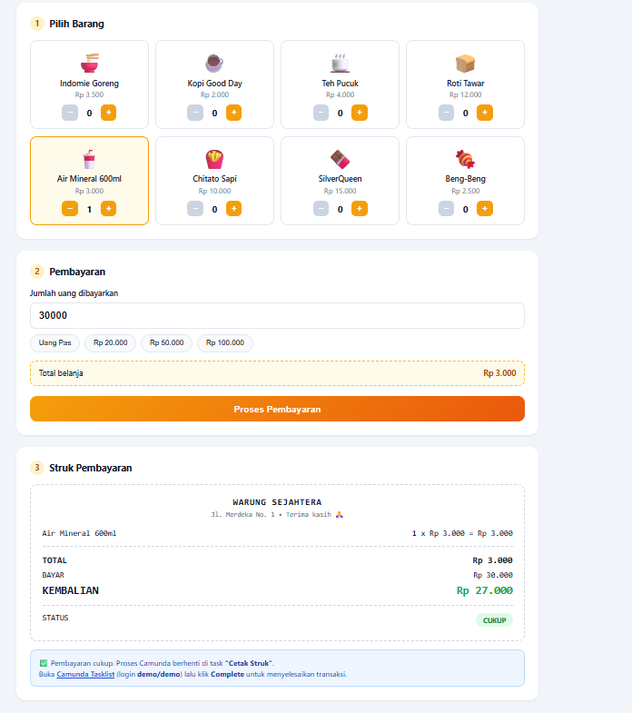

# 🏪 Warung Sejahtera — Sistem Kasir Sederhana dengan Camunda BPM

**UTS Project ADVSWE (Advanced Software Engineering)** — *Camunda Platform & Business Process Management*

| | |
|---|---|
| **Nama** | Keino Aflah |
| **Mata Kuliah** | ADVSWE |
| **Topik** | Camunda BPM + Spring Boot |
| **Repository** | [github.com/ArchKeix/UTS_PROJECT_ADVSWE_KeinoAflah](https://github.com/ArchKeix/UTS_PROJECT_ADVSWE_KeinoAflah) |

---

## 📋 Deskripsi Proyek

**Warung Sejahtera** adalah aplikasi **sistem kasir (Point of Sale) sederhana** untuk warung/kios kecil yang dibangun di atas **Camunda BPM Platform** dan **Spring Boot**.

Tidak seperti aplikasi kasir biasa, seluruh **logika bisnis perhitungan** pada aplikasi ini diorkestrasi oleh sebuah **proses BPMN** yang dijalankan oleh Camunda Process Engine. Artinya, alur "pilih barang → hitung total → hitung kembalian → cetak struk" dimodelkan secara visual sebagai diagram BPMN, dan setiap langkah perhitungan dijalankan oleh *service task* Camunda.

### Fitur Utama

| Fitur | Keterangan |
|---|---|
| 🛒 **Pilih Barang** | Katalog 8 barang warung (mie instan, kopi, teh, roti, air mineral, snack, cokelat) dengan tombol tambah/kurang jumlah |
| 🧮 **Hitung Total** | Total belanja dihitung otomatis oleh *service task* Camunda (`HitungTotalDelegate`) |
| 💵 **Hitung Kembalian** | Kembalian = uang bayar − total belanja, dihitung oleh *service task* Camunda (`HitungKembalianDelegate`) |
| 🧾 **Cetak Struk** | Struk pembayaran digital berisi rincian item, total, bayar, kembalian, dan status |
| ⚠️ **Validasi Pembayaran** | Jika uang kurang, proses otomatis dibatalkan melalui *exclusive gateway* |
| ✅ **Integrasi Tasklist** | Setelah pembayaran cukup, muncul task **"Cetak Struk"** di Camunda Tasklist yang harus di-*complete* kasir |

---

## 🛠 Teknologi yang Digunakan

| Teknologi | Versi | Fungsi |
|---|---|---|
| Java | 17 | Bahasa pemrograman utama |
| Spring Boot | 3.2.5 | Framework aplikasi web |
| Camunda BPM Platform | 7.21.0 | Process engine & workflow orchestration |
| Camunda Spring Boot Starter (Webapp) | 7.21.0 | Camunda Webapp (Cockpit, Tasklist, Admin) |
| H2 Database | (dari Spring Boot BOM) | Database in-memory untuk Camunda |
| Maven | (via wrapper `mvnw`) | Build & dependency management |

---

## 🔄 Diagram BPMN Proses

Proses Camunda pada aplikasi ini memiliki key **`ProsesWarung`** dengan nama **"Proses Transaksi Warung"**. Diagram lengkapnya bisa dilihat di **Camunda Cockpit → Process Definitions → ProsesWarung**, atau pada gambar berikut:



### Penjelasan Alur Proses (Flow)

```
┌─────────────────┐
│ Mulai Transaksi │  ← Start Event: dipicu saat kasir menekan
└────────┬────────┘    tombol "Proses Pembayaran" di halaman web
         ▼
┌─────────────────────┐
│  Hitung Total       │  ← Service Task #1 (HitungTotalDelegate)
│  Belanja            │    Menjumlahkan harga × qty setiap barang
└────────┬────────────┘    Output variabel: totalBelanja
         ▼
┌─────────────────────┐
│  Hitung Kembalian   │  ← Service Task #2 (HitungKembalianDelegate)
└────────┬────────────┘    kembalian = jumlahBayar − totalBelanja
         │                 Output variabel: kembalian, statusPembayaran
         ▼
   ┌─────────────┐
   ◆ Pembayaran  │  ← Exclusive Gateway: percabangan berdasarkan kondisi
   │  Cukup?     │
   └──┬───────┬──┘
      │       │
 Cukup│       │Kurang
      ▼       ▼
┌──────────┐ ┌──────────────────────────┐
│ Cetak    │ │ Transaksi Dibatalkan     │
│ Struk    │ │ - Uang Kurang            │
└────┬─────┘ └──────────────────────────┘
     │        ← End Event: proses selesai,
     ▼          struk TIDAK dicetak
┌─────────────────┐
│ Transaksi       │  ← User Task (assignee: demo):
│ Selesai         │    kasir klik "Complete" di
└─────────────────┘    Camunda Tasklist
                       ↓
                  End Event: transaksi selesai
```

### Rincian Setiap Elemen Diagram

| Elemen | Tipe | Keterangan |
|---|---|---|
| **Mulai Transaksi** | Start Event | Titik awal proses, dipicu dari `WarungController` via `runtimeService.startProcessInstanceByKey("ProsesWarung", variables)` |
| **Hitung Total Belanja** | Service Task | Dijalankan otomatis oleh class Java `HitungTotalDelegate`. Membaca variabel `daftarPesanan` (map kode barang → qty), mengalikan dengan harga dari `KatalogWarung`, lalu menyimpan hasilnya ke variabel `totalBelanja` |
| **Hitung Kembalian** | Service Task | Dijalankan otomatis oleh class Java `HitungKembalianDelegate`. Menghitung `kembalian = jumlahBayar − totalBelanja` dan menentukan `statusPembayaran` (`CUKUP` / `KURANG`) |
| **Pembayaran Cukup?** | Exclusive Gateway | Percabangan kondisi:<br>• **Cukup** → jika `${kembalian >= 0}`<br>• **Kurang** → jika `${kembalian < 0}` |
| **Cetak Struk** | User Task | Task manual untuk kasir (assignee: `demo`). Muncul di Camunda Tasklist; kasir mengklik **Complete** untuk meneruskan proses ke End Event |
| **Transaksi Selesai** | End Event | Proses berakhir normal (pembayaran cukup & struk sudah dikonfirmasi) |
| **Transaksi Dibatalkan - Uang Kurang** | End Event | Proses berakhir karena pembayaran tidak mencukupi |

### Variabel Proses (Process Variables)

| Variabel | Tipe | Dibuat oleh | Keterangan |
|---|---|---|---|
| `daftarPesanan` | `Map<String,Integer>` | `WarungController` | Map kode barang → jumlah beli, dikirim dari halaman kasir |
| `jumlahBayar` | `Long` | `WarungController` | Uang yang dibayarkan pelanggan |
| `totalBelanja` | `Long` | `HitungTotalDelegate` | Total harga seluruh barang |
| `kembalian` | `Long` | `HitungKembalianDelegate` | `jumlahBayar − totalBelanja` (negatif jika uang kurang) |
| `statusPembayaran` | `String` | `HitungKembalianDelegate` | `"CUKUP"` atau `"KURANG"` |

---

## 📁 Struktur Folder & Penjelasan File

```
hellocamunda/
├── pom.xml                                  # Konfigurasi Maven & dependency
├── mvnw / mvnw.cmd                          # Maven Wrapper (jalankan tanpa install Maven)
├── HELP.md                                  # Dokumentasi bawaan Spring Initializr
├── .gitignore                               # File/folder yang diabaikan Git (target/, .idea/, dll.)
├── docs/
│   ├── bpmn-diagram.png                     # Screenshot diagram BPMN dari Camunda Cockpit
│   └── output-kasir.png                     # Screenshot tampilan halaman kasir + struk
├── src/
│   ├── main/
│   │   ├── java/com/uts/adse/hellocamunda/
│   │   │   ├── HellocamundaApplication.java # Main class — entry point Spring Boot
│   │   │   ├── ServletInitializer.java      # Konfigurasi deploy sebagai WAR (bawaan)
│   │   │   ├── Barang.java                  # Record data barang (kode, nama, harga, emoji)
│   │   │   ├── KatalogWarung.java           # Daftar 8 barang warung (hardcoded) + helper cari
│   │   │   ├── PesananRequest.java          # Record request dari halaman kasir (items + bayar)
│   │   │   ├── WarungController.java        # REST API: /api/warung/katalog & /api/warung/hitung
│   │   │   └── delegate/
│   │   │       ├── HitungTotalDelegate.java      # Service Task 1: hitung total belanja
│   │   │       └── HitungKembalianDelegate.java  # Service Task 2: hitung kembalian
│   │   └── resources/
│   │       ├── application.yaml             # Konfigurasi port, database H2, user Camunda
│   │       ├── proses_warung.bpmn           # ⭐ Diagram BPMN "ProsesWarung"
│   │       └── static/
│   │           └── warung.html              # Halaman kasir (HTML + CSS + JavaScript)
│   └── test/
│       └── java/com/uts/adse/hellocamunda/
│           └── HellocamundaApplicationTests.java  # Test context load Spring Boot
└── target/                                  # Hasil build (diabaikan Git)
```

### Penjelasan File Penting

#### 1. `proses_warung.bpmn` — Diagram Proses Bisnis
File XML berisi definisi proses BPMN (key: `ProsesWarung`) yang di-*auto-deploy* oleh Camunda saat aplikasi start. Berisi: Start Event, 2 Service Task, 1 Exclusive Gateway, 1 User Task, dan 2 End Event beserta kondisi pada sequence flow-nya.

#### 2. `delegate/HitungTotalDelegate.java` — Logika Hitung Total
Implementasi `JavaDelegate` Camunda. Dipanggil otomatis oleh engine saat mencapai Service Task "Hitung Total Belanja". Mengiterasi variabel `daftarPesanan`, mencari harga tiap barang di `KatalogWarung`, menjumlahkan `harga × qty`, lalu menyimpan hasil ke variabel `totalBelanja`.

#### 3. `delegate/HitungKembalianDelegate.java` — Logika Hitung Kembalian
Implementasi `JavaDelegate`. Menghitung selisih antara `jumlahBayar` dan `totalBelanja`, lalu menyimpan `kembalian` dan `statusPembayaran` (`CUKUP`/`KURANG`) sebagai variabel proses untuk dievaluasi oleh gateway.

#### 4. `WarungController.java` — REST API Kasir
- `GET /api/warung/katalog` → mengembalikan daftar barang (JSON) untuk dirender di halaman kasir
- `POST /api/warung/hitung` → memvalidasi pesanan, **menjalankan proses Camunda `ProsesWarung`**, membaca variabel hasil perhitungan (via HistoryService), lalu mengembalikan data struk (total, bayar, kembalian, status, nama task)

#### 5. `KatalogWarung.java` — Data Barang
Menyimpan 8 barang warung beserta harga dan emoji:
Indomie Goreng (Rp 3.500), Kopi Good Day (Rp 2.000), Teh Pucuk (Rp 4.000), Roti Tawar (Rp 12.000), Air Mineral 600ml (Rp 3.000), Chitato Sapi (Rp 10.000), SilverQueen (Rp 15.000), Beng-Beng (Rp 2.500).

#### 6. `static/warung.html` — Halaman Kasir
Halaman tunggal (vanilla HTML/CSS/JavaScript, tanpa framework) dengan 3 bagian:
1. **Pilih Barang** — kartu katalog dengan stepper jumlah
2. **Pembayaran** — input uang + tombol cepat (Uang Pas, Rp 20.000, Rp 50.000, Rp 100.000)
3. **Struk Pembayaran** — hasil perhitungan dari proses Camunda

#### 7. `application.yaml` — Konfigurasi
```yaml
server:
  port: 8080
spring:
  datasource:
    url: jdbc:h2:mem:hellocamunda;DB_CLOSE_DELAY=-1   # database in-memory
camunda:
  bpm:
    generic-properties:
      properties:
        history-time-to-live: 7        # default TTL history proses
    admin-user:
      id: demo                          # user login Camunda Webapp
      password: demo
```

---

## 🚀 Cara Menjalankan

### Prasyarat
- **JDK 17** (disarankan; bisa juga JDK 21+)
- Tidak perlu install Maven (sudah ada Maven Wrapper `mvnw`)

### Langkah

```bash
# 1. Clone repository
git clone https://github.com/ArchKeix/UTS_PROJECT_ADVSWE_KeinoAflah.git
cd UTS_PROJECT_ADVSWE_KeinoAflah

# 2. Jalankan aplikasi
./mvnw spring-boot:run          # Linux/Mac
mvnw.cmd spring-boot:run        # Windows
```

Tunggu sampai muncul log `Started HellocamundaApplication`, lalu buka browser:

| URL | Halaman |
|---|---|
| `http://localhost:8080/warung.html` | **Halaman kasir** (utama) |
| `http://localhost:8080/` | Redirect ke Camunda Webapp |
| `http://localhost:8080/camunda/app/cockpit` | Camunda Cockpit (lihat proses & instance) |
| `http://localhost:8080/camunda/app/tasklist` | Camunda Tasklist (task "Cetak Struk") |
| `http://localhost:8080/camunda/app/admin` | Camunda Admin (manajemen user) |
| `http://localhost:8080/h2-console` | Konsol database H2 |

**Login Camunda Webapp:** `demo` / `demo`

---

## 📤 Dokumentasi Output

### 1. Tampilan Halaman Kasir



**Penjelasan tampilan pada gambar:**

1. **Bagian 1 — Pilih Barang**: grid 8 kartu barang. Pada contoh, **Air Mineral 600ml (Rp 3.000)** dipilih dengan jumlah **1** (kartu berubah jadi kuning/aktif).
2. **Bagian 2 — Pembayaran**: input diisi **30.000**, tersedia tombol cepat (*Uang Pas, Rp 20.000, Rp 50.000, Rp 100.000*). Kotak kuning menampilkan **Total belanja Rp 3.000** secara live. Tombol oranye **"Proses Pembayaran"** menjalankan proses Camunda.
3. **Bagian 3 — Struk Pembayaran**: struk digital menampilkan:
   - Rincian: `Air Mineral 600ml — 1 x Rp 3.000 = Rp 3.000`
   - **TOTAL: Rp 3.000**
   - **BAYAR: Rp 30.000**
   - **KEMBALIAN: Rp 27.000** (hijau = uang cukup)
   - **STATUS: CUKUP** (badge hijau)
   - Catatan biru: *"Pembayaran cukup. Proses Camunda berhenti di task 'Cetak Struk'. Buka Camunda Tasklist (login demo/demo) lalu klik Complete untuk menyelesaikan transaksi."*

### 2. Output Console (Log Camunda)

Saat transaksi diproses, kedua *JavaDelegate* mencetak log perhitungannya:

```
>>> [Camunda] Hitung Total Belanja: Rp 9000
>>> [Camunda] Bayar Rp 50000 - Total Rp 9000 = Kembalian Rp 41000 (CUKUP)
```

Log ini membuktikan bahwa perhitungan benar-benar dijalankan di dalam **Camunda Process Engine**, bukan di controller.

### 3. Contoh Response API

**Request** (`POST /api/warung/hitung`):
```json
{
  "items": { "MIE": 2, "KOPI": 1 },
  "bayar": 50000
}
```

**Response** (pembayaran cukup):
```json
{
  "processInstanceId": "5991af1f-c6c6-11f1-95c1-00155d026d92",
  "detail": [
    { "nama": "Indomie Goreng", "qty": 2, "harga": 3500, "subtotal": 7000 },
    { "nama": "Kopi Good Day",  "qty": 1, "harga": 2000, "subtotal": 2000 }
  ],
  "total": 9000,
  "bayar": 50000,
  "kembalian": 41000,
  "status": "CUKUP",
  "task": "Cetak Struk"
}
```

**Response** (uang kurang):
```json
{
  "detail": [ { "nama": "SilverQueen", "qty": 1, "harga": 15000, "subtotal": 15000 } ],
  "total": 15000,
  "bayar": 5000,
  "kembalian": -10000,
  "status": "KURANG",
  "task": null
}
```

### 4. Camunda Cockpit & Tasklist

- **Cockpit → Process Definitions**: proses `ProsesWarung` ter-deploy beserta diagramnya
- **Cockpit → Process Instances**: setiap transaksi tercatat sebagai instance (status *running* saat menunggu task, *ended* setelah selesai/dibatalkan)
- **Tasklist**: task **"Cetak Struk"** (assignee `demo`) muncul saat pembayaran cukup; klik **Complete** untuk menyelesaikan proses

---

## 🔌 API Endpoints

| Method | Endpoint | Deskripsi |
|---|---|---|
| `GET` | `/api/warung/katalog` | Daftar semua barang (`kode`, `nama`, `harga`, `emoji`) |
| `POST` | `/api/warung/hitung` | Jalankan proses Camunda; body: `{ "items": {"KODE": qty}, "bayar": number }` |

---

## 🧪 Hasil Pengujian

| Skenario | Barang | Total | Bayar | Kembalian | Status | Hasil di Tasklist |
|---|---|---|---|---|---|---|
| Uang cukup | Indomie x2 + Kopi x1 | Rp 9.000 | Rp 50.000 | **Rp 41.000** | CUKUP | Task "Cetak Struk" muncul ✅ |
| Uang pas | Air Mineral x1 | Rp 3.000 | Rp 3.000 | **Rp 0** | CUKUP | Task "Cetak Struk" muncul ✅ |
| Uang kurang | SilverQueen x1 | Rp 15.000 | Rp 5.000 | **−Rp 10.000** | KURANG | Proses dibatalkan ✅ |
| Tanpa barang | — | — | — | — | Error 400 | `"Pilih minimal satu barang dulu!"` ✅ |

---

## 📝 Catatan

- Project ini dibuat untuk memenuhi **UTS mata kuliah ADVSWE** dengan topik Camunda BPM.
- Database menggunakan **H2 in-memory**, sehingga data proses hilang setiap aplikasi di-restart (cukup untuk keperluan demo/UTS).
- Diagram BPMN dapat diedit kembali di [Camunda Modeler](https://camunda.com/download/modeler/) lalu file `.bpmn`-nya diganti.

## 👤 Author

**Keino Aflah** — [github.com/ArchKeix](https://github.com/ArchKeix)
